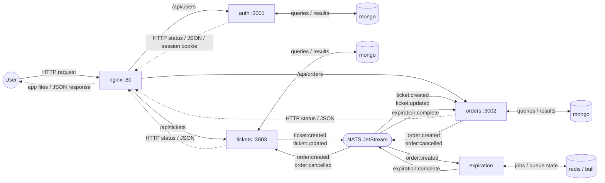

# Ticketing

TicTix is a small ticket marketplace built as event-driven microservices. Signed-in users list tickets for sale and edit their own unreserved tickets; other users reserve a ticket by creating an order. An order holds the ticket for a limited time (15 minutes by default) and is cancelled automatically when that time runs out, which releases the ticket for someone else. Users can also cancel their own orders. No payment flow is implemented.

The project shows how independent services, each owning its data, stay consistent through asynchronous NATS JetStream events rather than direct calls or distributed transactions, and how the whole stack runs locally, in Compose and in CI.

Repository layout:

- [backend/](backend): the `auth`, `tickets`, `orders` and `expiration` services and the shared `common` library.
- [client/](client): the React single-page app.
- [deploy/](deploy): nginx and NUI configuration.
- [scripts/](scripts): portable install, dev, test and Compose launchers.
- [test/](test): root manifest, Compose and live acceptance tests.
- [docs/](docs): design specs and implementation plans.

## Architecture

Event-driven microservices. Each service owns its data (separate databases on the MongoDB server in Compose). The frontend is a React single-page app built by Vite. In the production stack, nginx serves its static files and sends `/api` requests to the owning service; in development, the Vite dev server proxies `/api` itself. Backend services communicate asynchronously through NATS JetStream, using the event contracts defined in the local `common` package. No npm publication or Git push is required to use changes to the shared library.



Solid arrows show requests or published/delivered events; dotted arrows show HTTP responses, including errors. Data-store links show both directions. NATS events are asynchronous messages, not request/response calls between services.

### Technology responsibilities

| Technology | Purpose in this application | Used by | Example |
| --- | --- | --- | --- |
| NATS JetStream | Persists asynchronous events in the file-backed `TICKETING` stream; durable pull consumers acknowledge after processing. | `tickets`, `orders`, `expiration` | `orders` publishes `order:created`; tickets reserves the ticket and expiration schedules its job. |
| MongoDB | Stores domain data in service-owned databases: users and password hashes, tickets and reservation references, orders, and the orders service's local ticket copies. | `auth`, `tickets`, `orders` through Mongoose | Creating an order writes its status and expiration date to the orders database; an expiration event later updates that status. |
| Redis | Stores Bull's delayed jobs and queue-processing state. It is not the user/session database or a general application cache here. | `expiration` through Bull | A job containing an order ID waits until the order's expiration time, then the worker publishes `expiration:complete` through NATS. |

MongoDB stores the business records, Redis supports scheduled work, and NATS carries notifications between services. Redis does not cancel an order itself: the expiration worker publishes an event, `orders` updates MongoDB, and `tickets` releases the reservation after receiving `order:cancelled`.

Publishers await JetStream persistence acknowledgements. Delivery is at least once, not exactly once. The Compose broker is `nats`, uses `nats://nats:4222`, and persists to the `jetstream-data` volume. `NATS_CLUSTER_ID` is no longer used.

STAN history and durable positions cannot be read by JetStream. Stop the old publishers/consumers and STAN broker before a coordinated cutover, preserve their data, and reconcile existing projections and queued jobs. Starting JetStream does not migrate history; do not delete old volumes or perform a mixed STAN/JetStream rolling deployment.

### Services

| Service | Role | REST API | Publishes | Listens to |
| --- | --- | --- | --- | --- |
| `auth` | Sign up / sign in / sign out, JWT in cookie session | `/api/users/signup`, `/api/users/signin`, `/api/users/signout`, `/api/users/currentuser` | – | – |
| `tickets` | Tickets for sale; a ticket is locked while an order holds it | `GET/POST /api/tickets`, `GET/PUT /api/tickets/:id` | `ticket:created`, `ticket:updated` | `order:created`, `order:cancelled` |
| `orders` | Orders on tickets; keeps a local copy of tickets to validate them | `GET/POST /api/orders`, `GET/DELETE /api/orders/:id` | `order:created`, `order:cancelled` | `ticket:created`, `ticket:updated`, `expiration:complete` |
| `expiration` | Schedules a delayed Bull job (Redis) when an order is created and fires `expiration:complete` when the delay elapses | – | `expiration:complete` | `order:created` |
| `client` | React single-page app built by Vite, served by nginx in production | – | – | – |
| `common` | Private local library: error classes, middlewares (auth, validation), base listener/publisher and event types; compiled into each backend image | – | – | – |

### Order lifecycle

1. `tickets` publishes `ticket:created` / `ticket:updated`; `orders` mirrors the ticket locally.
2. A user creates an order: `orders` publishes `order:created`.
3. `tickets` marks the ticket as reserved; `expiration` schedules a Bull job.
4. When the job fires, `expiration` publishes `expiration:complete`.
5. `orders` cancels the unpaid order and publishes `order:cancelled`, which releases the ticket in `tickets`.

`docker-compose.yaml` is the production stack. `docker-compose.dev.yaml` is an overlay that exposes the infrastructure to local development.

## Docker compose

Run direct Compose commands from the repository root. No host Node installation or npm wrapper is needed for the full container stack. Docker Desktop works directly on Windows; Podman requires a Compose provider (validated in WSL with Podman 4.9.3 and podman-compose 1.6.0).

### Production stack

```bash
cp .env.example .env   # then fill JWT_KEY and MONGO_ROOT_PASSWORD
docker compose up --build -d
docker compose ps
```

`.env` is git-ignored; only `.env.example` is committed, and it is the only env file in the repository. Generate each secret with `openssl rand -base64 48`. `JWT_KEY` and `MONGO_ROOT_PASSWORD` are required: Compose stops with a `JWT_KEY is required` message when `.env` is missing or still has the empty values from `.env.example`. Keep the same MongoDB credentials when reusing an initialized database.

The stack is nginx, client, auth, tickets, orders, expiration, MongoDB, Redis and NATS JetStream. Only nginx publishes a port (`HTTP_PORT`, default `80`):

```text
http://localhost  -> nginx -> /api/users/*  -> auth:3001
                           -> /api/tickets* -> tickets:3003
                           -> /api/orders*  -> orders:3002
                           -> /*            -> app files built by Vite (index.html fallback)
```

The nginx configuration is [deploy/nginx/default.conf](deploy/nginx/default.conf). The nginx image is built from [client/Dockerfile](client/Dockerfile): a Node 24 stage runs `vite build`, and nginx serves the result, answering every page URL with `index.html` (so deep links and reloads work) and returning 404 for unknown `/api` paths. `index.html` is never cached; hashed files under `/assets/` are cached for a year. There is no frontend server process. Backend images run as the `node` user with `NODE_ENV=production` and already contain the compiled common library. Application images use Node 24.

Security limits: HTTP only (no TLS, no domain); session cookies are not marked `secure`; Redis and NATS have no authentication and rely on the internal Compose network.

Optional shortcut: `npm run compose:up` builds and starts this stack together with the dev overlay, so the infrastructure ports are also published on `127.0.0.1` and Redis Insight and NUI run (see [Infrastructure containers and local watch](#infrastructure-containers-and-local-watch)). `npm run compose:acceptance` keeps the plain production stack. The shortcuts use `docker compose` when `docker` is on PATH, otherwise `podman compose` when `podman` is; with neither they stop with an error. The order is the same on every platform, the selected engine is printed, and a failure keeps its exit status without switching engines.

Host npm workflows require Node 24 (see `.nvmrc`). Every root command runs in the shell it is launched from (PowerShell, cmd, Git Bash, a WSL terminal, Linux or macOS) with that environment's Node, npm and Docker/Podman; nothing is forwarded to WSL. If you previously installed through the old WSL launchers, reinstall with `npm install` from the shell you work in: the existing `node_modules` folders hold Linux-only native builds.

The shared multistage build lives in `backend/common/Dockerfile`. Its `common` target compiles the library; its `service` target builds a backend selected by the `SERVICE` build argument. These Compose builds keep the repository root as their context so they can access both the shared library and consumer source. The client has its own multistage `client/Dockerfile`.

- Application: <http://localhost>
- Stop the stack: `npm run compose:down`

### Infrastructure containers and local watch

For application development, keep infrastructure in containers and run the apps from the checkout:

```bash
cp .env.example .env   # once; infra mode needs the same secrets
npm run install
npm run compose:infra
npm run dev
```

`compose:infra` stops this project's application containers and nginx, then starts MongoDB, Redis, NATS JetStream, Redis Insight and NUI with the dev overlay, which publishes every port on `127.0.0.1` only (27017, 6379, 4222, 8222, 15540 and 31311). NATS is required by tickets, orders and expiration, so MongoDB and Redis alone cannot support the complete application. The direct equivalent is `docker compose -f docker-compose.yaml -f docker-compose.dev.yaml up -d mongo redis nats redisinsight nui`.

`npm run dev` loads the root `.env` (variables already exported in the shell win), builds common once, then runs its TypeScript watcher, the four backend watchers and the Vite development server together. Backend source changes restart the affected service; compiled common changes are also included in backend watch paths. The client uses Vite hot reload, and the Vite dev server proxies `/api` to the localhost backends. It listens on `localhost` only, so use <http://localhost:3000>.

Press Ctrl+C to stop the local watchers; infrastructure remains running until `npm run compose:down`. Development serves the application at <http://localhost:3000>.

Data browsers (infra mode and `compose:up`):

- MongoDB: use [MongoDB Compass](https://www.mongodb.com/products/tools/compass) on the host with `mongodb://root:<MONGO_ROOT_PASSWORD>@127.0.0.1:27017/?authSource=admin`.
- Redis Insight, started by `compose:infra` and `compose:up`: <http://127.0.0.1:15540>. Accept its EULA on first visit; the preconfigured `ticketing` connection to `redis:6379` then appears. Its free edition has no login, so it relies on the loopback binding, and its settings reset when the container is recreated.
- NATS JetStream, through [NUI](https://natsnui.app) started by `compose:infra` and `compose:up`: <http://127.0.0.1:31311>. The `ticketing` connection to `nats://nats:4222` is imported at startup from [deploy/nui/ticketing.json](deploy/nui/ticketing.json); open it to browse the `TICKETING` stream and its messages, inspect consumers or subscribe to subjects. NUI has no login, so it relies on the loopback binding, and its settings reset when the container is recreated.

All client requests run in the browser on the frontend origin. In development, `AUTH_API_URL`, `ORDERS_API_URL` and `TICKETS_API_URL` set the Vite proxy targets; the local dev launcher supplies localhost defaults. Production needs none of them: nginx routes `/api`. The dev launcher also supplies development JWT, MongoDB, NATS and Redis defaults when neither the shell nor `.env` sets them.

## Shared library

Auth, tickets, orders, and expiration declare `@elie29/ticketing-common` as `file:../common`. The package is private and has no publish script. Its JavaScript and TypeScript declarations are generated in `backend/common/build`.

For development outside containers, run dependency commands from the repository root, in any shell, with Node 24:

```bash
npm run install
npm run update
```

`npm run install` clean-installs the root tooling and all six packages using their lockfiles. It installs/builds common before installing auth, tickets, orders, expiration, and client. The root install script also runs automatically when using `npm install`.

`npm run update` updates the root tooling and package dependencies within each manifest's declared version ranges and refreshes the lockfiles. It updates/builds common before updating its consumers and the client; it does not force major-version migrations. Both commands stop on failure and forward additional npm options to every package. Preview dependency updates without applying them:

```bash
npm run update -- --dry-run
```

In local watch mode, common recompiles and affected backends restart automatically. Outside watch mode, rebuild with `npm --prefix backend/common run build` and restart consumers. For containers, use `npm run compose:up` to rebuild the images from current source; each backend image compiles its own copy of common. If Podman retains an old application container after rebuilding, recreate the affected service explicitly, for example `podman compose up -d --force-recreate --no-deps client`.

All packages target Node 24 and use matching ranges for shared direct dependencies. `npm run test:manifests` checks that alignment, local common lock metadata, private/local package conventions, backend scripts, test layout and Compose dispatch.

## Package Documentation

Run package commands from the root with `npm --prefix backend/<name> run <script>` (or `npm --prefix client run <script>`).

- [Auth](backend/auth/README.md): users, password hashing and cookie sessions.
- [Tickets](backend/tickets/README.md): ownership, versioning and reservations.
- [Orders](backend/orders/README.md): ticket projection and order lifecycle.
- [Expiration](backend/expiration/README.md): Bull scheduling and JetStream publication.
- [Common](backend/common/README.md): local contracts, middleware and transport.
- [Client](client/README.md): catalogue, ticket creation/editing, owned orders and authentication screens.
- [Scripts](scripts/README.md): portable development command dispatch.
- [Root tests](test/README.md): live-stack requirements and regression coverage.

The client supports ticket search, reservation, confirmed cancellation, server-status polling and expiry countdowns. It does not implement payments or infer currency.

## Tests

Install dependencies, then run the default gate. It needs no container stack:

```bash
npm run install
npm test
```

Start the full container stack before running the complete gate, which adds live acceptance:

```bash
npm run compose:acceptance
npm run test:all
```

All automated suites use Vitest 5 on Node 24, including the HTTP acceptance and routing tests. Vitest handles TypeScript directly; Jest, SWC test transforms, and the Node test runner are no longer required. TypeScript typechecks remain separate from test execution.

A single [vitest.config.mts](vitest.config.mts) at the root defines every suite as a named project: `root`, `client`, `common`, `common-broker`, `auth`, `tickets`, `orders` and `expiration`. Each project keeps its own include pattern, setup file and timeouts; packages have no Vitest config of their own. Every package still runs its own tests from its own folder with its own Vitest install, by pointing at that file (`vitest run --config ../../vitest.config.mts --project <name>`). The root launcher runs only the `root` and `client` projects. The config imports Vitest types only, so a package run does not need the root dependencies installed.

`npm test` runs manifest/Compose checks, common HTTP/JetStream contracts, all four backend suites, shared/backend typechecks, an undefined-name lint of the client (ESLint), the frontend production build, and client routing/helper checks. None of these require Docker or Podman; the Compose dispatch check uses a stub engine. `npm run test:all` adds live acceptance against the running stack. The complete root command passed locally on Node 24 after moving all backend tests outside source: 100 tests passed with no skipped tests, plus typechecks and the client build. Acceptance used real MongoDB, Redis/Bull, and JetStream. A new GitHub Actions run has not been verified.

Each backend keeps specs, setup and mock factories in `test/` beside `src/`. Root, common and client retain their existing external test folders. No backend test-only code remains in source.

The [isolated broker suite](backend/common/README.md#real-broker-verification) additionally passed 2 tests for replay, independent consumers, durable resume and redelivery, bringing executed automated checks to 102. CI has a separate real-broker job. Desktop/mobile browser checks also exercised signup, ticket creation, reservation, cancellation, release and order history; focus/label checks and overflow checks passed at the inspected viewports. These are focused checks, not a comprehensive external security/accessibility audit.

`compose:acceptance` builds/starts the real application stack with a 15-second order lifetime so the automatic-expiration scenario finishes quickly. Normal startup keeps the 900-second default. The orders service validates `ORDER_EXPIRATION_SECONDS` as a positive integer. Recreate orders with the normal environment when returning to ordinary development, for example `docker compose up -d --force-recreate --no-deps orders` with no lifetime override exported.

Run individual gates from the root:

```bash
npm run test:manifests
npm run test:routing
npm run test:services
npm run test:acceptance
```

`test:services` runs common/backend checks and the frontend production build without requiring the Compose stack. Backend suites start temporary MongoDB instances; the first run may need to download a MongoDB binary. Run this build-oriented command outside a running local `npm run dev`, since both use the client's build directory. Each backend also exposes `typecheck`, `test` (one Vitest run of its project), `test:watch` (interactive Vitest watch of its project), and `test:ci` scripts through `npm --prefix backend/<service> run <script>`. Root test launchers run natively in the launching shell, like install/update.

Acceptance tests need a running application: either full Compose or local watch mode backed by infrastructure containers. They wait for frontend/API readiness, then check that page URLs (including a deep link) return the app shell while API paths reach the services, and exercise authentication cookies, validation errors, authorization, and event-driven ticket reservation/cancellation. The automatic-expiration test observes the returned `expiresAt`, checks that the order is not cancelled early, waits for Redis/Bull and NATS to cancel it and release its ticket, and verifies the ticket can be reserved again. It does not manually cancel the order whose automatic expiration is being checked.

The suite creates uniquely named test users and tickets and cleans up its extra reservation. Use a development/test stack, not production. The suite targets `ACCEPTANCE_BASE_URL` when set, otherwise nginx at `http://localhost:${HTTP_PORT}`, otherwise `http://localhost`; `npm run test:acceptance` reads `HTTP_PORT` from the root `.env` when the shell has not set it (only that variable). Set `ACCEPTANCE_BASE_URL=http://localhost:3000` for local watch mode, or another URL for a different frontend. On a normally configured stack the expiration case can take fifteen minutes; use `compose:acceptance` for the short test lifetime. The real brokers, database, and expiration worker are not mocked in acceptance tests.

## Ports

Production stack: only nginx is published, on `HTTP_PORT` (Compose default 80; `.env.example` sets 8080). Inside the Compose network and in local watch mode:

- auth: 3001
- client: 3000
- orders: 3002
- tickets: 3003

Infra mode publishes MongoDB 27017, Redis 6379, NATS 4222/8222, Redis Insight 15540 and NUI 31311, all on `127.0.0.1`.

## Github actions

### Test

- The tests workflow runs `auth`, `orders`, `tickets`, and `expiration` as parallel matrix jobs on Node 24. Each job clean-installs and tests common first, installs root Vitest tooling with lifecycle scripts disabled, checks manifest alignment, then clean-installs, typechecks, and tests its service. A failing service does not cancel the others.
- A separate client job clean-installs the frontend, runs manifest/routing checks, and builds the client with Vite.
- A separate broker job starts a disposable JetStream instance and checks replay, independent groups, durable resume and redelivery.
- An acceptance job builds/starts the production Compose stack with `ORDER_EXPIRATION_SECONDS=15` and throwaway CI-only `JWT_KEY` / `MONGO_ROOT_PASSWORD` values, so the tests go through nginx, installs root Vitest tooling, runs all six acceptance tests, prints container logs on failure, and stops the stack afterward.
- The workflow runs on pull requests and pushes to `main` when package source, root scripts/tests, the root manifest/lockfile/Vitest config, the Compose files, the nginx configuration, or the workflow changes, and supports manual dispatch. The Vitest migration's GitHub-hosted run has not been independently verified; the complete local root gate has passed.
