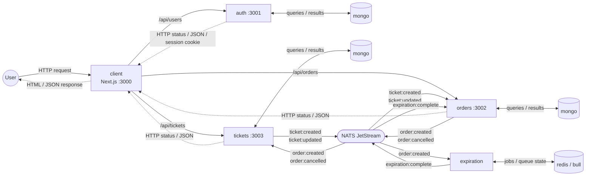

# Ticketing

## Architecture

Event-driven microservices. Each service owns its data (separate databases on the MongoDB server in Compose). The Next.js frontend proxies `/api` requests to the owning service. Backend services communicate asynchronously through NATS JetStream, using the event contracts defined in the local `common` package. No npm publication or Git push is required to use changes to the shared library.



Solid arrows show requests or published/delivered events; dotted arrows show HTTP responses, including errors. Data-store links show both directions. NATS events are asynchronous messages, not request/response calls between services.

### Technology responsibilities

| Technology | Purpose in this application | Used by | Example |
| --- | --- | --- | --- |
| NATS JetStream | Persists asynchronous events in the file-backed `TICKETING` stream; durable pull consumers acknowledge after processing. | `tickets`, `orders`, `expiration` | `orders` publishes `order:created`; tickets reserves the ticket and expiration schedules its job. |
| MongoDB | Stores domain data in service-owned databases: users and password hashes, tickets and reservation references, orders, and the orders service's local ticket copies. | `auth`, `tickets`, `orders` through Mongoose | Creating an order writes its status and expiration date to the orders database; an expiration event later updates that status. |
| Redis | Stores Bull's delayed jobs and queue-processing state. It is not the user/session database or a general application cache here. | `expiration` through Bull | A job containing an order ID waits until the order's expiration time, then the worker publishes `expiration:complete` through NATS. |

MongoDB stores the business records, Redis supports scheduled work, and NATS carries notifications between services. Redis does not cancel an order itself: the expiration worker publishes an event, `orders` updates MongoDB, and `tickets` releases the reservation after receiving `order:cancelled`.

Publishers await JetStream persistence acknowledgements. Delivery is at least once, not exactly once. The Compose broker is `nats`, uses `nats://nats:4222`, and persists to the `jetstream-data` volume. `NATS_CLUSTER_ID` is no longer used.

STAN history and durable positions cannot be read by JetStream. Stop the old publishers/consumers and STAN broker before a coordinated cutover, preserve their data, and reconcile existing projections and queued jobs. Starting JetStream does not migrate history; do not delete old volumes or perform a mixed STAN/JetStream rolling deployment.

### Services

| Service | Role | REST API | Publishes | Listens to |
| --- | --- | --- | --- | --- |
| `auth` | Sign up / sign in / sign out, JWT in cookie session | `/api/users/signup`, `/api/users/signin`, `/api/users/signout`, `/api/users/currentuser` | – | – |
| `tickets` | Tickets for sale; a ticket is locked while an order holds it | `GET/POST /api/tickets`, `GET/PUT /api/tickets/:id` | `ticket:created`, `ticket:updated` | `order:created`, `order:cancelled` |
| `orders` | Orders on tickets; keeps a local copy of tickets to validate them | `GET/POST /api/orders`, `GET/DELETE /api/orders/:id` | `order:created`, `order:cancelled` | `ticket:created`, `ticket:updated`, `expiration:complete` |
| `expiration` | Schedules a delayed Bull job (Redis) when an order is created and fires `expiration:complete` when the delay elapses | – | `expiration:complete` | `order:created` |
| `client` | Next.js front end | – | – | – |
| `common` | Private local library: error classes, middlewares (auth, validation), base listener/publisher and event types; one-shot build service in Compose | – | – | – |

### Order lifecycle

1. `tickets` publishes `ticket:created` / `ticket:updated`; `orders` mirrors the ticket locally.
2. A user creates an order: `orders` publishes `order:created`.
3. `tickets` marks the ticket as reserved; `expiration` schedules a Bull job.
4. When the job fires, `expiration` publishes `expiration:complete`.
5. `orders` cancels the unpaid order and publishes `order:cancelled`, which releases the ticket in `tickets`.

All application and infrastructure services are configured in `docker-compose.yaml`.

## Docker compose

Run direct Compose commands from the repository root. No host Node installation or npm wrapper is needed for the full container stack. Docker Desktop works directly on Windows; Podman requires a Compose provider (validated in WSL with Podman 4.9.3 and podman-compose 1.6.0).

The default file starts all applications, common builder, MongoDB, Redis and JetStream. Only mongo-express is opt-in through the `tools` profile. These containers are development-only; no production Docker targets or production Compose deployment are supplied.

### Full container stack

```bash
docker compose up --build -d
```

Or with Podman in WSL/Linux:

```bash
podman compose up --build -d
podman compose ps
```

Compose builds `common` as a one-shot service. Auth, tickets, orders, and expiration wait for it to finish successfully, then use its compiled output from the read-only `common-build` volume. A successfully exited `common` container is expected; it is a library builder, not an HTTP server. Application images use Node 24. Add `--profile tools` before `up` to include mongo-express.

Optional shortcut: `npm run compose:up`. Its engine selection is `COMPOSE_BIN` first, then native Windows Docker when on PATH, otherwise Windows WSL/Podman; on Linux prefer Podman, otherwise Docker. The selected engine is printed and failures retain their exit status without silently switching engines. `COMPOSE_BIN` is an executable path or a JSON array of executable/arguments, not an evaluated shell command. For Node-based overrides, use `--` before the script to prevent Node consuming forwarded options. Selector/stub tests cover these branches; an actual Docker Desktop daemon is not available here.

Host npm workflows require Node 24 (see `.nvmrc`). Install/update/test/dev commands still use WSL when launched on Windows so they use Linux-installed dependencies; Compose is routed before that relay.

The shared multistage build lives in `common/Dockerfile`. Its `common` target compiles the library; its `service` target builds a backend selected by the `SERVICE` build argument. These Compose builds keep the repository root as their context so they can access both the shared library and consumer source. The client retains its own `client/Dockerfile`.

To build only the shared-library image:

```bash
podman compose build common
```

- Application: <http://localhost:3000>
- Optional Mongo express: <http://localhost:18081> (development login: admin/local-dev-password)
- Stop the stack: `npm run compose:down`

### Infrastructure containers and local watch

For application development, keep infrastructure in containers and run the apps from the checkout:

Direct infrastructure startup is `docker compose up -d mongo redis nats` or `podman compose up -d mongo redis nats`. If full app containers are already running, stop `common auth tickets orders expiration client` first to avoid port conflicts; `npm run compose:infra` handles that switch and also stops mongo-express.

```bash
npm run install
npm run compose:infra
npm run dev
```

`compose:infra` stops this project's application containers and mongo-express, then starts MongoDB, Redis, and NATS JetStream only. NATS is required by tickets, orders, and expiration, so MongoDB and Redis alone cannot support the complete application. For a database/cache-only task, `podman compose up -d mongo redis` selects just those two services.

`npm run dev` builds common once, then runs its TypeScript watcher, the four backend watchers, and the Next.js development server together. Backend source changes restart the affected service; compiled common changes are also included in backend watch paths. The client uses Next.js hot reload. Local development connects to the infrastructure's published localhost ports and uses localhost API proxy targets instead of container DNS names.

Press Ctrl+C to stop the local watchers; infrastructure remains running until `npm run compose:down`. Stop the local dev command before switching back to `npm run compose:up`, since both modes use ports 3000-3003. Both modes serve the application at <http://localhost:3000>.

Compose's JWT and database credentials are development defaults, not production secrets. Set `JWT_KEY`, `MONGO_ROOT_USERNAME`, and `MONGO_ROOT_PASSWORD` in the environment before starting to override them. Keep the same MongoDB credentials when reusing an initialized database.

The client uses `API_BASE_URL` for server-side requests and `AUTH_API_URL`, `ORDERS_API_URL`, and `TICKETS_API_URL` for internal API rewrites. Full Compose sets these to service DNS names; the local dev launcher supplies localhost defaults. Browser requests remain on the frontend origin. The dev launcher also supplies development JWT, MongoDB, NATS, and Redis settings; exported environment values override its shared defaults.

## Shared library

Auth, tickets, orders, and expiration declare `@elie29/ticketing-common` as `file:../common`. The package is private and has no publish script. Its JavaScript and TypeScript declarations are generated in `common/build`.

For development outside containers, run dependency commands from the repository root inside WSL with Node 24:

```bash
npm run install
npm run update
```

`npm run install` clean-installs the root tooling and all six packages using their lockfiles. It installs/builds common before installing auth, tickets, orders, expiration, and client. The root install script also runs automatically when using `npm install`.

`npm run update` updates the root tooling and package dependencies within each manifest's declared version ranges and refreshes the lockfiles. It updates/builds common before updating its consumers and the client; it does not force major-version migrations. Both commands stop on failure and forward additional npm options to every package. Preview dependency updates without applying them:

```bash
npm run update -- --dry-run
```

In local watch mode, common recompiles and affected backends restart automatically. Outside watch mode, rebuild with `npm --prefix common run build` and restart consumers. For containers, use `npm run compose:up` to rebuild the stack from current source. If Podman retains an old application container after rebuilding, recreate the affected service explicitly, for example `podman compose --profile app up -d --force-recreate --no-deps client`.

If an existing `common-build` volume contains stale exports, rebuild its contents with `podman compose --profile app build common` followed by `podman compose --profile app run --rm common`, then recreate the affected backends. Do not delete database or broker volumes to refresh compiled code.

All packages target Node 24 and use matching ranges for shared direct dependencies. `npm run test:manifests` checks that alignment, local common lock metadata, private/local package conventions, backend scripts, test layout and Compose dispatch.

## Package Documentation

- [Auth](auth/README.md): users, password hashing and cookie sessions.
- [Tickets](tickets/README.md): ownership, versioning and reservations.
- [Orders](orders/README.md): ticket projection and order lifecycle.
- [Expiration](expiration/README.md): Bull scheduling and JetStream publication.
- [Common](common/README.md): local contracts, middleware and transport.
- [Client](client/README.md): catalogue, ticket creation/editing, owned orders and authentication screens.
- [Scripts](scripts/README.md): portable development command dispatch.
- [Root tests](test/README.md): live-stack requirements and regression coverage.

The client supports ticket search, reservation, confirmed cancellation, server-status polling and expiry countdowns. It does not implement payments or infer currency.

## VS Code Tasks

[.vscode/tasks.json](.vscode/tasks.json) provides optional reusable tasks for installation, development, container lifecycle, typechecks/service tests/builds, manifests, client tests and acceptance. Use **Terminal > Run Task**. Start either full containers or local watchers, not both on the same ports. Prepare the acceptance stack before **Ticketing: Test All**. Tasks invoke existing npm scripts and are not required by the app or CI; no one-off migration scripts remain.

## Tests

Install dependencies, then run the default gate. It needs no container stack:

```bash
npm run install
npm test
```

Start the full container stack before running the complete gate, which adds live acceptance:

```bash
npm run compose:acceptance
npm run test:all
```

All automated suites use Vitest 5 on Node 24, including the HTTP acceptance and routing tests. Vitest handles TypeScript directly; Jest, SWC test transforms, and the Node test runner are no longer required. TypeScript typechecks remain separate from test execution.

`npm test` runs manifest/Compose checks, common HTTP/JetStream contracts, all four backend suites, shared/backend typechecks, the frontend production build, and client routing/helper checks. None of these require Docker or Podman; the Compose dispatch check uses a stub engine. `npm run test:all` adds live acceptance against the running stack. The complete root command passed locally on Node 24 after moving all backend tests outside source: 100 tests passed with no skipped tests, plus typechecks and the client build. Acceptance used real MongoDB, Redis/Bull, and JetStream. A new GitHub Actions run has not been verified. The Next build is a compilation check, not a production Docker deliverable.

Each backend keeps specs, setup and mock factories in `test/` beside `src/`. Root, common and client retain their existing external test folders. No backend test-only code remains in source.

The [isolated broker suite](common/README.md#real-broker-verification) additionally passed 2 tests for replay, independent consumers, durable resume and redelivery, bringing executed automated checks to 102. CI has a separate real-broker job. Desktop/mobile browser checks also exercised signup, ticket creation, reservation, cancellation, release and order history; focus/label checks and overflow checks passed at the inspected viewports. These are focused checks, not a comprehensive external security/accessibility audit.

`compose:acceptance` builds/starts the real application stack with a 15-second order lifetime so the automatic-expiration scenario finishes quickly. Normal startup keeps the 900-second default. The orders service validates `ORDER_EXPIRATION_SECONDS` as a positive integer. Recreate orders with the normal environment when returning to ordinary development, for example `podman compose --profile app up -d --force-recreate --no-deps orders` with no lifetime override exported.

Run individual gates from the root:

```bash
npm run test:manifests
npm run test:routing
npm run test:services
npm run test:acceptance
```

`test:services` runs common/backend checks and the frontend production build without requiring the Compose stack. Backend suites start temporary MongoDB instances; the first run may need to download a MongoDB binary. Run this build-oriented command outside a running local `npm run dev`, since both use the client's build directory. Each backend also exposes `typecheck`, `test` (one Vitest run), `test:watch` (interactive Vitest watch), and `test:ci` scripts through `npm --prefix <service> run <script>`. Root test launchers use WSL from Windows so they resolve the same Linux-installed tooling as install/update.

Acceptance tests need a running application: either full Compose or local watch mode backed by infrastructure containers. They wait for frontend/API readiness, then exercise rendered pages, authentication cookies, validation errors, authorization, and event-driven ticket reservation/cancellation. The automatic-expiration test observes the returned `expiresAt`, checks that the order is not cancelled early, waits for Redis/Bull and NATS to cancel it and release its ticket, and verifies the ticket can be reserved again. It does not manually cancel the order whose automatic expiration is being checked.

The suite creates uniquely named test users and tickets and cleans up its extra reservation. Use a development/test stack, not production. Set `ACCEPTANCE_BASE_URL` to target another frontend. On a normally configured stack the expiration case can take fifteen minutes; use `compose:acceptance` for the short test lifetime. The real brokers, database, and expiration worker are not mocked in acceptance tests.

## Ports

- auth: 3001
- client: 3000
- orders: 3002
- tickets: 3003

## Github actions

### Test

- The tests workflow runs `auth`, `orders`, `tickets`, and `expiration` as parallel matrix jobs on Node 24. Each job clean-installs and tests common first, installs root Vitest tooling with lifecycle scripts disabled, checks manifest alignment, then clean-installs, typechecks, and tests its service. A failing service does not cancel the others.
- A separate client job clean-installs the frontend, runs manifest/routing checks, and builds Next.js for production.
- A separate broker job starts a disposable JetStream instance and checks replay, independent groups, durable resume and redelivery.
- An acceptance job builds/starts default Compose with `ORDER_EXPIRATION_SECONDS=15`, installs root Vitest tooling, runs all six acceptance tests, prints container logs on failure, and stops the stack afterward.
- The workflow runs on pull requests and pushes to `main` when package source, root scripts/tests, the root manifest/lockfile/Vitest config, or the workflow changes, and supports manual dispatch. The Vitest migration's GitHub-hosted run has not been independently verified; the complete local root gate has passed.
